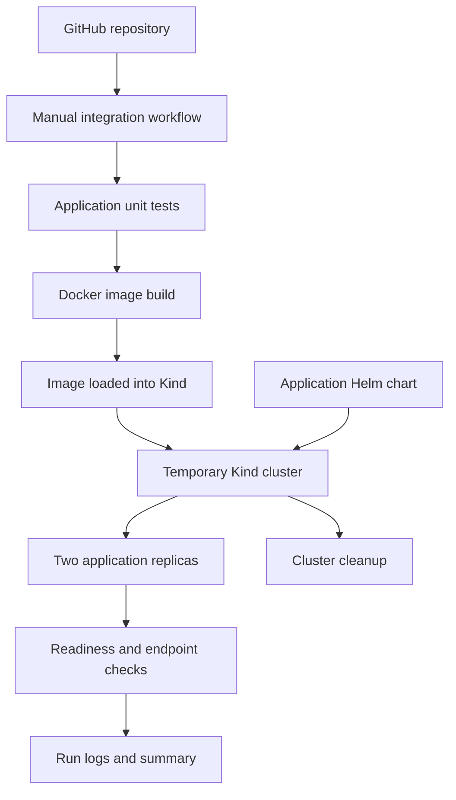
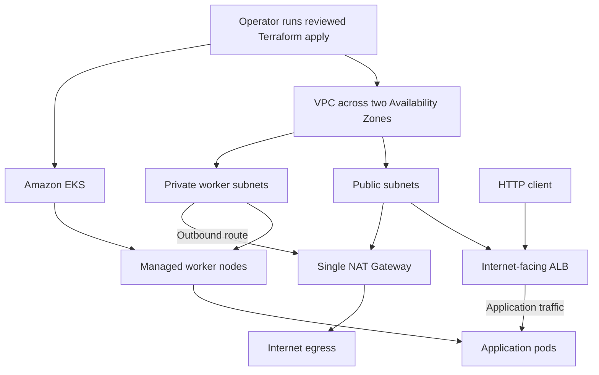
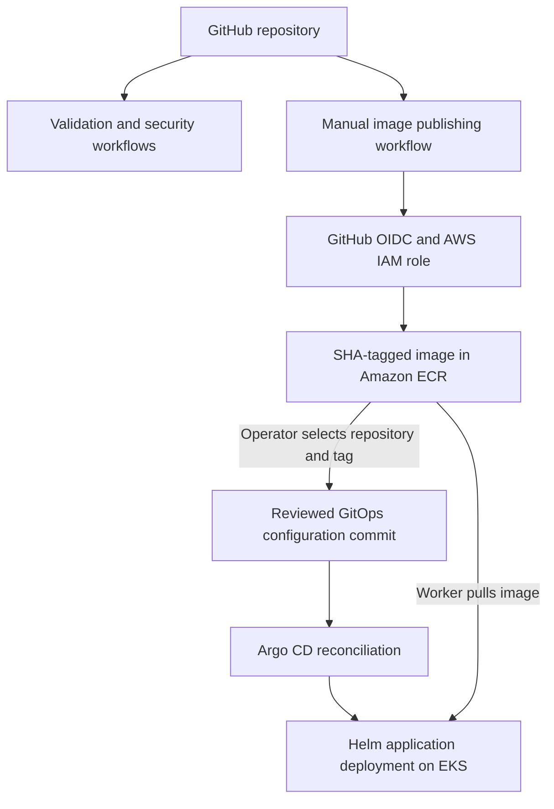
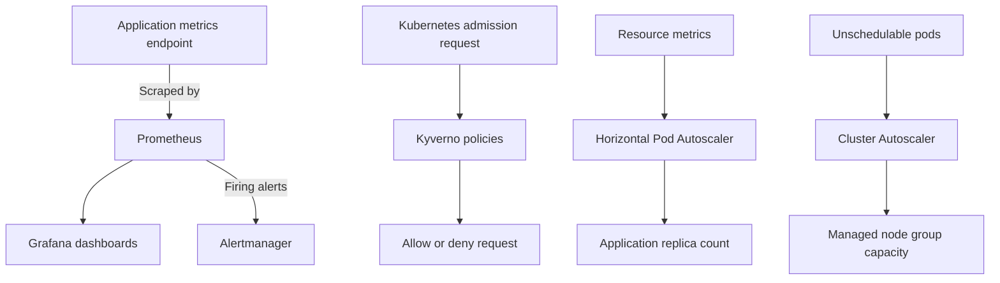

# Platform architecture

This project has two distinct environments:

- A temporary Kind cluster used for application integration testing in GitHub Actions.
- A development AWS EKS platform deployed and tested separately, then destroyed to control costs.

The AWS results are summarised in the repository README and supporting evidence. Neither environment serves production customer traffic.

## Application integration testing with Kind

The manual GitHub Actions integration workflow builds the application image locally and loads it into a temporary Kind cluster. This test does not use Amazon ECR or provision AWS resources.

The test checks deployment readiness and HTTP responses through a Service port-forward. Both replicas must become Ready, but endpoint checks reach the selected pod. This does not demonstrate load balancing across replicas.

The default Kind network does not enforce NetworkPolicy. AWS services and the complete platform controller stack are outside this integration test.

## Tested AWS development platform

The development platform was provisioned with Terraform and tested on Amazon EKS. The exercise covered application deployment, public ALB access, monitoring, admission policies, autoscaling and GitOps behaviour.

The environment was destroyed after testing. The Terraform bootstrap state bucket was retained.

### Infrastructure and application traffic

The VPC separates public load-balancer and NAT subnets from private worker subnets.

The development configuration uses a single NAT Gateway for private-node outbound connectivity. This reduces lab cost but introduces a shared egress dependency.

For an ALB configured with IP targets, the AWS Load Balancer Controller registers application pod IPs using Kubernetes endpoint information. Application traffic flows from the ALB directly to those targets rather than through the Service ClusterIP.

The live exercise reached `/health` and `/ready` through the public ALB with HTTP 200 responses. This verifies the tested application path, not every route, subnet or failure scenario.

### Image publishing and GitOps delivery

Terraform provisioning is a separate operator action. The image-publishing workflow does not run Terraform or automatically update the GitOps image reference.

The publishing workflow tags the image with a Git commit SHA. An operator must update the ECR repository and published tag in GitOps configuration through a reviewed commit.

Argo CD reconciles the application against that configuration. Publishing an image alone does not trigger a deployment.

The AWS exercise tested automatic correction of a manual configuration change and a configuration rollback through Git revert. It did not demonstrate an image-version rollback.

### Monitoring, policy and scaling

The reported live validation covered:

- Prometheus scraping the application and Grafana displaying metrics.
- Application alert rules being loaded.
- A synthetic alert firing and reaching Alertmanager.
- Kyverno denying a noncompliant test pod during server-side dry run in the `platform` namespace.
- HPA increasing application replicas from 2 to 4 during a bounded load test.
- A second worker node becoming Ready during the scaling test.

External Slack or email notification delivery was not tested. Exact node scale-down timing was not recorded.

These results demonstrate specific test outcomes, not production capacity or resilience guarantees.

## Identity boundaries

GitHub OIDC and EKS Pod Identity serve different purposes:

| Identity mechanism | Purpose | Verification scope |
|---|---|---|
| GitHub OIDC with an AWS IAM role | Temporary AWS credentials for the image-publishing workflow | ECR publication was reported as tested |
| EKS Pod Identity | AWS API access for configured Kubernetes controllers | Requires the agent, associations and suitable IAM permissions; this document does not independently establish live credential delivery |

Successful application deployment alone does not verify every controller's credential path. Controller identity claims should be supported by the relevant configuration, logs or AWS evidence.

## Deployment procedure

1. Run validation and review the results.
2. Review the Terraform plan, permissions, configuration and expected cost.
3. Provision the development AWS infrastructure.
4. Run the manual publishing workflow to test, scan and publish the SHA-tagged image.
5. Update the ECR repository and image tag in GitOps configuration.
6. Bootstrap Argo CD and its applications using the deployment runbook.
7. Verify synchronisation, workload readiness, ALB target health and endpoint responses.
8. Verify monitoring, policy enforcement and scaling separately.
9. Collect evidence, destroy the temporary environment and check cleanup.

The image and development VPC from the live exercise were deleted. Recreating the platform requires a newly published image and appropriate environment-specific configuration.

See:

- [Deployment runbook](deployment-runbook.md)
- [Cost and teardown runbook](cost-and-teardown-runbook.md)
- [Evidence guide](evidence-guide.md)
- [Rollback runbook](rollback-runbook.md)

## Availability and design tradeoffs

The development environment prioritises learning and cost control.

- Subnets span two Availability Zones, but this alone does not establish workload high availability.
- The live example starts with one worker node. A second node was observed during the scaling test.
- Two application replicas can share a worker node.
- Zone spreading is a scheduling preference rather than a strict placement guarantee.
- A single NAT Gateway creates a shared outbound connectivity dependency.
- Monitoring storage was temporary.
- Public application testing used HTTP. Production TLS remains further work.
- No measured node-failure or Availability Zone failure test is established here.

The project therefore demonstrates a production-style development platform, not proven production high availability.

The application has no demonstrated business-data persistence. Application database backup and restore are outside the implemented scope.

A production implementation would require stronger availability controls, TLS, durable observability, a managed secrets lifecycle and measured recovery objectives.
