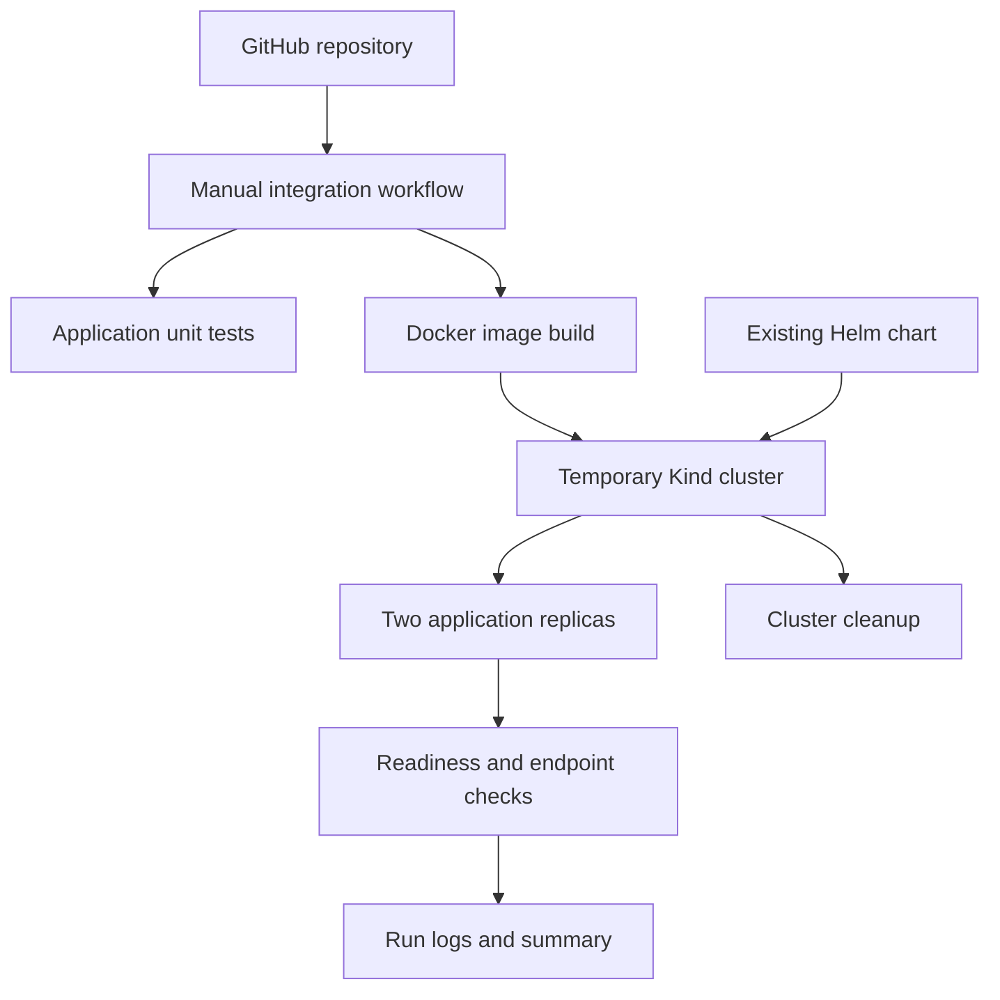
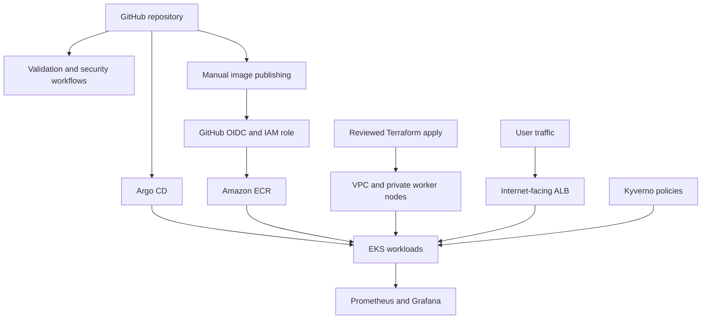

# Platform architecture

## Tested application environment

The successful manual GitHub Actions run used Kind, not EKS. The runner built the application image locally and loaded it into the temporary cluster without ECR.

The test checks deployment readiness and HTTP responses through a Service port-forward. Both replicas must become Ready, but endpoint checks reach the selected pod, so this is not a load-balancing test. The default Kind network does not enforce NetworkPolicy. Platform controllers and AWS services are outside this test.

## Target AWS design: not yet deployed

Terraform provisioning is a separate operator action. The current publishing workflow does not run Terraform or change the GitOps image tag. The diagram describes the intended runtime relationships, not an already operating AWS environment.

## Networking and identity

- The VPC configuration separates public load-balancer/NAT subnets from private EKS node subnets across two Availability Zones.
- The live-values example enables NAT egress for private-node bootstrap and image downloads. The routes and connectivity still need live verification.
- With ALB IP targets, the controller resolves Kubernetes Service endpoints and registers pod IPs. The ALB forwards application traffic directly to those targets rather than through the Service ClusterIP.
- GitHub OIDC is intended for image publication. EKS Pod Identity is intended for controller access to AWS APIs. These are separate trust relationships.
- Pod Identity requires its agent and working associations. Their configuration has not yet demonstrated live credential delivery.

## Delivery handoff

1. Run validation and review results.
2. Provision the reviewed AWS infrastructure during an approved deployment window.
3. Run the manual publishing workflow to test, scan and publish the SHA-tagged image.
4. Update the placeholder ECR repository and image tag in GitOps configuration through a reviewed commit.
5. Bootstrap Argo CD and its applications using the deployment procedure.
6. Verify sync, workload readiness, ALB health and endpoint responses.
7. Verify monitoring, policy enforcement and scaling separately.
8. Collect evidence and tear down temporary AWS resources.

Publishing an image alone does not make Argo CD deploy it. The configured tag must change in Git.

## Design tradeoffs

The development environment prioritises temporary learning and cost control. Small node limits, a single NAT gateway and temporary monitoring storage do not demonstrate production high availability or durable observability. The application has no demonstrated business-data persistence, so application database backup/restore is outside the implemented scope.